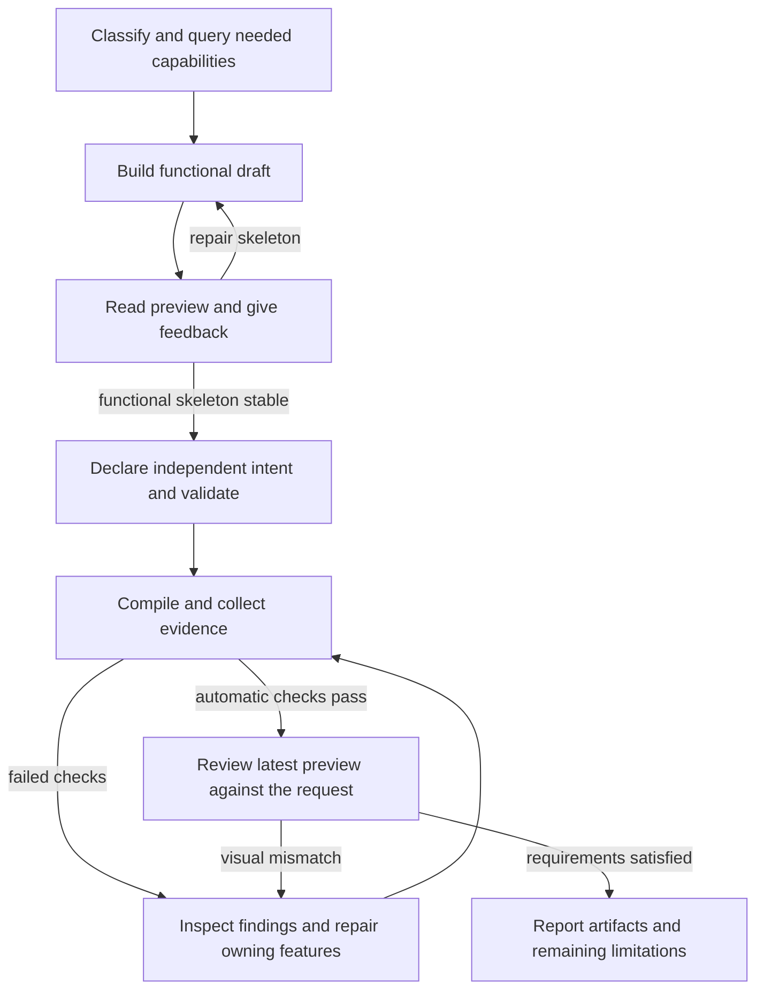

# Evidence-gated CAD workflow

> **简体中文**：[查看中文版](./cad-workflow.zh-CN.md)

Amagine3D separates the requested design, editable geometry, and evidence about
the generated result. A repair should improve geometry against the requirements;
changing a requirement or losing a downstream check must not look like progress.
This is a contributor overview. The agent's operating instructions remain in
[`a3d-text/SKILL.md`](../skills/a3d-text/SKILL.md).

## Responsibilities

| Layer | Responsibility |
| --- | --- |
| Agent and skill | Classify the request, choose relevant capabilities, read previews, and decide what to repair. |
| [`a3d agent`](../skills/a3d-public/agent_api.py) | Bind task inputs and outputs, reuse verified successful runs, recover context, and expose bounded report queries. |
| [`cad_compile.py`](../skills/a3d-public/cad_compile.py) | Validate contracts, execute source, check exports and freshness, and record findings. It never edits source, intent, or geometry. |
| [`intent_revision.py`](../skills/a3d-public/intent_revision.py) | Verify frozen intent bytes and revision ancestry; identify requirement changes separately from geometry repairs. |

The agent chooses the next action. The compiler and repair ledger do not run an
automatic repair loop, choose fixes, or impose a retry count.

## From draft to review

Start with only the capability contracts and references needed for the current
construction decision. Build a functional skeleton, inspect its actual preview,
and resolve form and access problems before finishing. Once it is stable, declare
independent intent targets and a printer profile, validate, and compile before
more cosmetic edits. A draft or static validation does not establish final
dimensions, installation fit, or printability.

For failures, use `a3d agent inspect` with the returned report path and SHA.
Read issue IDs, owners, actual/expected values, and repair hints; follow
`page.nextRequest` until the relevant findings are covered. Group shared causes
and repair the owning features together. Read deeper references only when the
specific decision or failure needs them. After continuation or compaction,
`a3d agent context` recovers evidence and exact next queries.

## Gates that preserve trust

1. **Reuse requires more than an unchanged source hash.** A successful draft or
   automatically passed compile can be reused only while its bound inputs,
   outputs, phase, and capability version still match. Inputs include the
   source/design revision, applicable intent, scene and profile, local Python
   imports, and explicitly declared data dependencies. Compile reuse also checks
   intent lineage. Missing, changed, failed, or interrupted evidence permits a
   new attempt. The skill asks for changed inputs, new evidence, or incomplete
   work to justify a repeat; it is not a blanket ban on retrying the same source.
   See the [task API contract](../skills/a3d-public/references/cad-agent-api.md).

2. **Requirements stay independent of repairs.** Intent owns acceptance targets;
   editable source/design owns controls; the scene binds physical parts and
   features to the intent. Frozen intent files are byte-immutable. A legitimate
   revision uses a new file linked to the current verified parent path and SHA,
   with a reason and the required user-request or external-evidence record.
   Renaming a file or changing the output directory does not reset the model's
   lineage. Declared revision evidence is not independent proof of authorization.
   See the [intent contract](../skills/a3d-public/references/evidence-contract.md).

3. **Evidence must describe this attempt.** The compiler snapshots inputs,
   validates scene/build bindings, checks the generated geometry and applicable
   manufacturing outputs, and audits artifact hashes and freshness. A failed
   upstream dependency leaves downstream checks blocked rather than presumed
   passed. Inspect the preview named by the current result; an older successful
   render pointer can survive a failed attempt. Diagnostic previews help locate
   faults but cannot establish manufacturing acceptance. See the
   [compile boundary](../skills/a3d-public/references/cad-compile.md).

4. **Automatic success still needs visual review.** `pass=true` leaves the result
   at `awaiting-visual-review`, with `visualReviewRequired=true`. The agent must
   use `view_image` on the actual preview, compare it with the request, and report unresolved
   warnings and limitations. Viewing an image does not change those compiler
   fields; there is no separate post-review acceptance API. A checkpoint records
   agent observations, not proof of image review or CAD acceptance.

When manufacturing passes but PNG evidence is incomplete, the result is
`awaiting-preview` with `pass=false`. Use context's `nextDisplay` request for
`a3d agent display`: it verifies and reuses the original manufacturing proof and
rebuilds the display without rerunning source or manufacturing checks. A
successful display retry still requires visual review. Changed or unverifiable
proof cannot be reused this way.

## Reading repair progress

The compiler's `_write_repair_state` maintains `<model>_repair-state.json` in the
workspace across the model's verified revision lineage. It records `failed`,
`blocked`, and `passedStages`; the result's `repairDelta` compares issue identities:

| Delta | Meaning |
| --- | --- |
| `new` | A failure not previously failed, blocked, or known resolved. |
| `newlyUnblocked` | A previously blocked check now ran and failed; this is newly available evidence. |
| `remaining` | A failure persists from the previous attempt. |
| `resolved` | A finding disappeared after reevaluation without a target scope change. |
| `regressed` | A previously resolved failure returned. |
| `scope_changed` | A finding disappeared across a target change; this does not prove a repair. |

For example, an opening check can be blocked while its owning solid is missing,
become `newlyUnblocked` when the solid exists but the cut misses it, become
`resolved` after the cut is repaired, and later become `regressed` if it breaks
again. If a source failure prevents reevaluation, the old downstream finding
remains blocked (`NOT_REEVALUATED`). If the issue-identity algorithm changes,
`identityComparable=false` starts a new comparison baseline without claiming
progress.

Existing coverage lives in
[`test_agent_api.py`](../tests/python/test_agent_api.py) (reuse and display recovery),
[`test_intent_revisions.py`](../tests/python/test_intent_revisions.py) (frozen targets
and scope changes), and [`test_cad_compile.py`](../tests/python/test_cad_compile.py)
(compile evidence and repair deltas).
