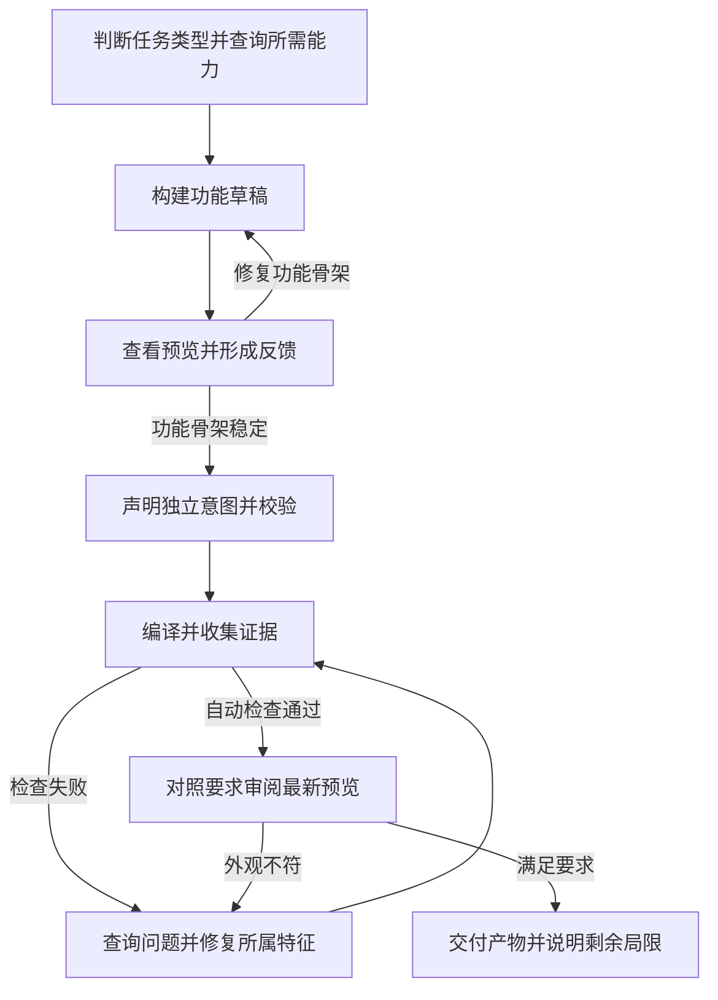

# 以证据为依据的 CAD 修复流程

> **English**: [View the English version](./cad-workflow.md)

Amagine3D 将设计要求、可编辑几何和生成结果的证据分开保存。修复应让几何满足要求；
修改要求或跳过下游检查，不能被当作修复进展。本文是面向贡献者的架构概览，
Agent 的操作入口仍是 [`a3d-text/SKILL.md`](../skills/a3d-text/SKILL.md)。

## 职责划分

| 层级 | 职责 |
| --- | --- |
| Agent 与 skill | 判断任务类型，选择相关能力，查看预览，决定修复内容。 |
| [`a3d agent`](../skills/a3d-public/agent_api.py) | 绑定任务输入与输出，复用经过验证的成功运行，恢复上下文，提供有输出大小限制的报告查询。 |
| [`cad_compile.py`](../skills/a3d-public/cad_compile.py) | 校验契约、执行源码、检查导出产物及其时效性、记录发现；不会修改源码、意图或几何。 |
| [`intent_revision.py`](../skills/a3d-public/intent_revision.py) | 验证已冻结意图的原始字节和版本祖先，将需求变化与几何修复分别记录。 |

下一步行动由 Agent 决定。编译器和修复记录不会自动循环修复、选择修复方案或规定重试次数。

## 从草稿到审阅

开始时只读取当前构造决策需要的能力契约和参考资料。先搭建功能骨架、查看实际预览，
在精修外观前解决形态和装配通路问题。骨架稳定后，声明独立的意图目标和打印配置，
完成校验及首次编译，再继续外观调整。草稿或静态校验不能证明最终尺寸、安装配合或可打印性。

遇到失败时，用返回的报告路径和 SHA 调用 `a3d agent inspect`，读取问题 ID、所属对象、
实际值与期望值、修复提示；沿 `page.nextRequest` 获取相关发现。将共同原因归组，
集中修复对应特征。仅在具体决策或错误需要时读取深入参考资料。续接任务或上下文压缩后，
使用 `a3d agent context` 恢复证据和下一步查询的准确参数。

## 保证证据可信的检查

1. **复用不能只看源码哈希。** 只有成功草稿或自动检查通过的编译，且绑定的输入、输出、
   构建阶段和能力版本仍一致时，才可复用。输入包括源码或设计版本、适用的意图、场景和
   打印配置、本地 Python 导入，以及显式声明的数据依赖；编译复用还会验证意图版本链。
   证据缺失、变化、失败或中断时可以重新尝试。Skill 要求重复操作有输入变化、新证据或
   未完成工作作为依据，并非一律禁止对相同源码重试。详见
   [任务 API 契约](../skills/a3d-public/references/cad-agent-api.md)。

2. **需求独立于修复。** 意图定义验收目标，可编辑源码或设计定义控制参数，场景将物理零件
   和特征绑定到意图。冻结后的意图文件连原始字节也不可修改。合理修订必须另存为新文件，
   关联当前已验证父版本的路径和 SHA，记录原因，并按修订类型提供用户请求或外部证据。
   改文件名或输出目录不会重置模型的版本链；声明的修订证据也不是经过独立验证的授权。
   详见 [意图契约](../skills/a3d-public/references/evidence-contract.md)。

3. **证据必须对应本次运行。** 编译器保存输入快照，验证场景与构建绑定，检查生成几何及
   适用的制造产物，并核验产物哈希和时效性。上游依赖失败时，下游检查记为受阻，不能视为
   已通过。查看当前结果指向的预览；失败运行可能保留上一次成功的渲染指针。
   诊断预览可用于定位问题，不能证明制造验收通过。详见
   [编译边界](../skills/a3d-public/references/cad-compile.md)。

4. **自动通过后仍需视觉审阅。** `pass=true` 时状态仍为 `awaiting-visual-review`，
   且 `visualReviewRequired=true`。Agent 必须用 `view_image` 查看实际预览、对照用户要求，并说明
   未解决的警告和局限。查看图片不会修改这些编译结果字段，也没有单独的审阅后验收 API。
   Checkpoint 只记录 Agent 的观察，不证明已经看图或 CAD 已通过验收。

如果制造检查通过但 PNG 证据不完整，状态为 `awaiting-preview`、`pass=false`。
使用 context 返回的 `nextDisplay` 请求调用 `a3d agent display`，核验并复用原始制造证据，
只重新生成显示结果，无需重跑源码或制造检查。显示重试成功后仍需视觉审阅。
已经变化或无法验证的证据不能这样复用。

## 如何理解修复进展

编译器的 `_write_repair_state` 在工作区维护 `<model>_repair-state.json`，
沿模型已验证的版本链保留记录。它保存 `failed`、`blocked` 和 `passedStages`，
结果中的 `repairDelta` 则比较各次运行的问题标识：

| 差异字段 | 含义 |
| --- | --- |
| `new` | 此前未失败、未受阻，也未被记为已解决的新失败。 |
| `newlyUnblocked` | 此前受阻的检查本次得以执行，但检查失败；这是新获得的证据。 |
| `remaining` | 上一次的失败仍存在。 |
| `resolved` | 在目标范围未变化的情况下，重新检查后该问题消失。 |
| `regressed` | 曾经解决的失败再次出现。 |
| `scope_changed` | 问题在目标变更后消失，不能据此认定几何已修复。 |

例如，开孔检查可能因所属实体缺失而受阻；实体补齐但切割未命中时记为 `newlyUnblocked`；
修正切割后记为 `resolved`；后续再次破坏开孔则记为 `regressed`。若源码失败导致下游
无法重新检查，原有问题继续记为受阻（`NOT_REEVALUATED`）。若问题标识算法发生变化，
`identityComparable=false` 表示建立新的比较基线，不据此宣称取得进展。

已有测试可参考 [`test_agent_api.py`](../tests/python/test_agent_api.py)（复用与显示恢复）、
[`test_intent_revisions.py`](../tests/python/test_intent_revisions.py)（目标冻结与范围变化）及
[`test_cad_compile.py`](../tests/python/test_cad_compile.py)（编译证据与修复差异）。
